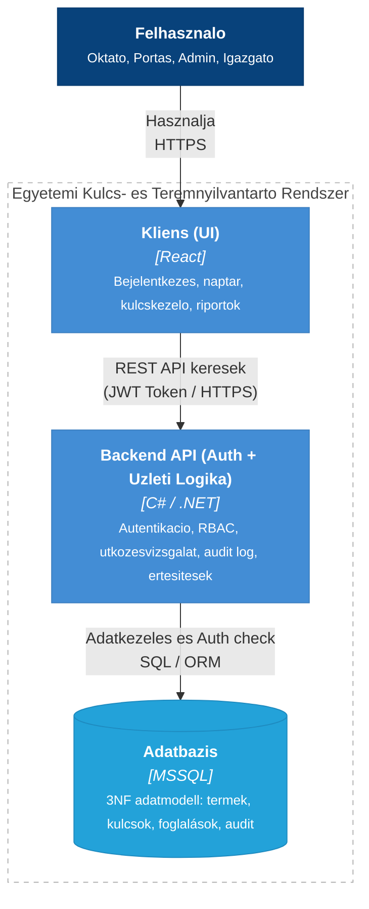
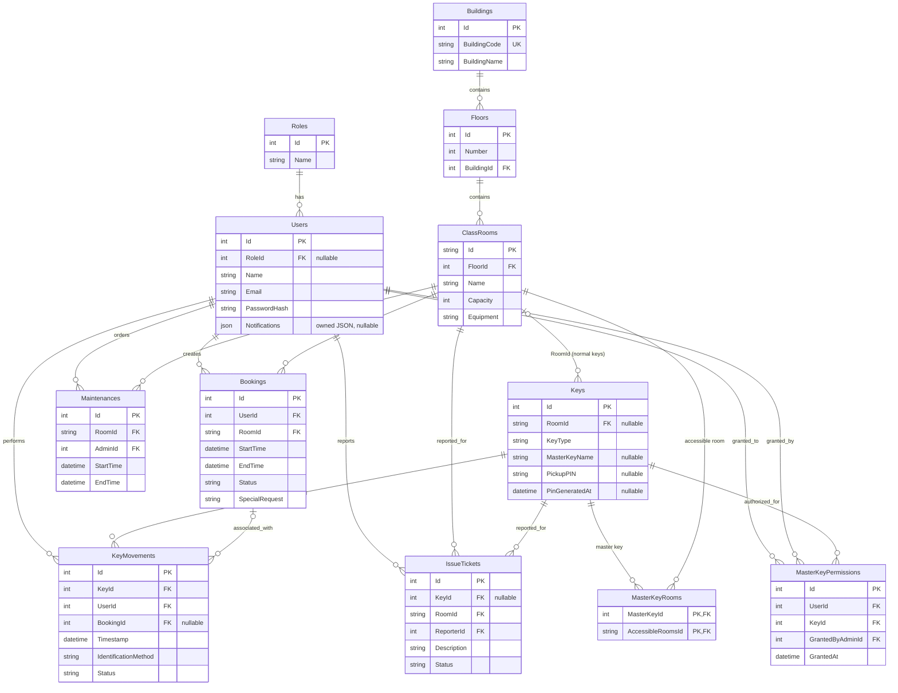

# egyetemi-kulcskezelo

Egyetemi Kulcs- és Teremnyilvántartó Rendszer PROJEKT LABOR - 2026/27/1 Csoport munka

---

## 1. A projekt celja es attekintese

Az egyetemi oktatasi termek, laborok, valamint a hozzajuk tartozo fizikai kulcsok nyilvantartasa gyakran manualisan, papiralapon tortenik, ami adminisztracios terhet, kulcselvesztest es foglalasi utkozeseket eredmenyez.

A rendszer celja egy kozpontositott, digitalis felulet biztositasa, amely:

- Valos idoben koveti a fizikai kulcsok kiadasat es visszavetelet.
- Kezeli az oktatok idopontalapu teremfoglalasait es a termek kapacitasat.
- Digitalis hibajegykezelo modult nyujt a serult kulcsok, zarak vagy teremi eszkozok bejelentesere.
- Adminisztratori engedelyhez koti a mesterkulcsok felvetelet es audit naplot vezet a folyamatokrol.

---

## 2. Szerepkorok es jogosultsagok

| Szerepkor    | Jogosultsagok es feladatok                                                                                                                                      |
| :----------- | :-------------------------------------------------------------------------------------------------------------------------------------------------------------- |
| **Oktato**   | Szabad termek keresese kapacitas alapjan, teremfoglalas inditasa, sajat foglalasok megtekintese, hibajegyek bejelentese.                                        |
| **Portas**   | Kulcsok fizikai kiadasanak es visszavetelenek gyors rogzitese, kulcsstatuszok lekerdezese (benn/kint), serulesek es vesztesegek azonnali jelzese.               |
| **Admin**    | Felhasznaloi fiokok es szerepkorok kezelese, uj termek es kulcsok felvitele, karbantartasok elrendelese, mesterkulcs-jogok kiosztasa, teljes audit log elerese. |
| **Igazgato** | Statisztikai kimutatasok, kihasznaltsagi riportok es hibanaplok megtekintese (olvasasi jog).                                                                    |

---

## 3. Rendszerinditas es fejlesztoi kornyezet

A projekt egy tobbkonteneres kornyezetben fut, amely magaban foglalja a **React** frontendet, a **.NET Core** backend REST API-t, valamint az **MSSQL** adatbazis-kiszolgalot. A teljes infrastruktura a legegyszerubben Docker segitsegevel indithato el.

### Elokovetelmenyek

- [Docker Desktop](https://www.docker.com/) telepitve es futtatva
- [Git](https://git-scm.com/)

### Gyors inditas

A projekt gyokerkonyvtaraban masold le a fejlesztoi kornyezet valtozoit tartalmazo mintafajlt, majd inditsd el a teljes stacket:

```bash
cp .env.sample .env
docker compose up --build
```

A kontener-infrastruktura leallitasa:

```bash
docker compose down
```

### A futo szolgaltatasok portjai:

- Backend: 5000:8080
- Frontend: 3000:80
- Database: 1433:1433

### Fejlesztoi tesztfiok

| Szerepkor | Nev           | E-mail / felhasznalonev | Jelszo         |
| :-------- | :------------ | :---------------------- | :------------- |
| Admin     | Rendszergazda | `admin@example.com`     | `Password123!` |

---

## 4. Rendszerarchitektura (C4 Container szint)



---

## 5. Adatbazis sema (ER Diagram)

A kulcsok TPH (Table-per-Hierarchy) öröklést használnak: a normál kulcsok és a mesterkulcsok közös `Keys` táblában tárolódnak, a `KeyType` mezővel megkülönböztetve. A mesterkulcsok számára az EF Core `MasterKeyRooms` összekötő táblát hoz létre a hozzáférhető termekhez.



## 6. API dokumentáció

Az API alap URL-je fejleszteskor `http://localhost:5000`. Az alábbi útvonalak erre az alapra értendők. A kapcsos zárójelben szereplő értékeket valós azonosítókra kell cserélni.

### Health és gyökér végpont

| Method | Útvonal       | Leírás                                                            | Jogosultság |
| ------ | ------------- | ----------------------------------------------------------------- | ----------- |
| GET    | `/`           | Egyszerű üzenettel jelzi, hogy az alkalmazás elindult.            | Nyilvános   |
| GET    | `/api/health` | Az alkalmazás és az adatbázis health check állapotát adja vissza. | Nyilvános   |

### Auditnaplo

| Method | Útvonal                             | Leírás                                                                                                        | Jogosultság |
| ------ | ----------------------------------- | ------------------------------------------------------------------------------------------------------------- | ----------- |
| GET    | `/api/audit-log?page=1&pageSize=50` | Lapozott audit-eseményeket ad vissza. Opcionális szűrők: `fromUtc`, `toUtcExclusive`, `method`, `statusCode`. | Igazgató    |

Az API minden HTTP-műveletet naplóz (a CORS `OPTIONS` előellenőrzéseket kivéve), beleértve a sikertelen hitelesítési és jogosultsági válaszokat is. A napló JSON Lines formátumban, az API `App_Data/audit-log.jsonl` fájljába kerül; az `AuditLog:Directory` konfigurációval a könyvtár felülbírálható. A napló külön fájlban tárolódik, nem az adatbázisban. Kérés- és választestet, query stringet, IP-címet és hitelesítési adatot nem tárol; a kliens `User-Agent` értékét igen. A Docker Compose `audit_log_data` kötete az `/app/App_Data` könyvtárat tartóssá teszi.

### User

| Method | Útvonal                            | Leírás                                                                                  | Jogosultság    |
| ------ | ---------------------------------- | --------------------------------------------------------------------------------------- | -------------- |
| GET    | `/api/User/get`                    | A token alapján bejelentkezett felhasználó adatait adja vissza.                         | Bejelentkezett |
| GET    | `/api/User`                        | Az összes felhasználót listázza.                                                        | Admin          |
| GET    | `/api/User/info/{id}`              | Egy felhasználó részletes adatait adja vissza.                                          | Admin          |
| GET    | `/api/User/roles`                  | A szerepkörök listája.                                                                  | Admin          |
| GET    | `/api/User/notifications`          | A bejelentkezett felhasználó értesítéseit listázza.                                     | Bejelentkezett |
| POST   | `/api/User/create`                 | Felhasználó regisztrálása. JSON: `Name`, `Email`, `Password`; JWT tokent ad vissza.     | Nyilvános      |
| POST   | `/api/User/login`                  | Bejelentkezés. JSON: `Email`, `Password`; JWT tokent ad vissza.                         | Nyilvános      |
| PUT    | `/api/User/update`                 | A bejelentkezett felhasználó adatainak módosítása. JSON: `Name`, `Email`, `Password`.   | Bejelentkezett |
| POST   | `/api/User/change-password`        | Jelszócsere. JSON: `OldPassword`, `NewPassword`, `ConfirmPassword`.                     | Bejelentkezett |
| DELETE | `/api/User/{id}`                   | Felhasználó törlése.                                                                    | Admin          |
| POST   | `/api/User/role/{userId}`          | A body-ban kapott egész role ID-t hozzárendeli a felhasználóhoz.                        | Admin          |
| POST   | `/api/User/role`                   | Új szerepkör létrehozása. JSON: `Name`.                                                 | Admin          |
| DELETE | `/api/User/role/{id}`              | Szerepkör törlése azonosító alapján.                                                    | Admin          |
| DELETE | `/api/User/role/remove/{id}`       | Az `{id}` felhasználóról eltávolítja a szerepkört.                                      | Admin          |
| POST   | `/api/User/{userId}/notifications` | JSON szöveges üzenetet ad hozzá a megadott felhasználó értesítéseihez.                  | Bejelentkezett |
| POST   | `/api/User/check-unreturned`       | Későn vissza nem adott kulcsokat keres; értesítést és a találatok listáját adja vissza. | Bejelentkezett |
| DELETE | `/api/User/notifications`          | A bejelentkezett felhasználó értesítéseit törli.                                        | Bejelentkezett |

### Building

| Method | Útvonal                     | Leírás                                                    | Jogosultság    |
| ------ | --------------------------- | --------------------------------------------------------- | -------------- |
| GET    | `/api/Building/getall`      | Az összes épülettel kapcsolatos adatot visszaadja.        | Bejelentkezett |
| GET    | `/api/Building/get/{id}`    | Egy épület alapadatai.                                    | Bejelentkezett |
| GET    | `/api/Building/info/{id}`   | Egy épület részletes adatai.                              | Bejelentkezett |
| POST   | `/api/Building/create`      | Épület létrehozása. JSON: `BuildingCode`, `BuildingName`. | Admin          |
| PUT    | `/api/Building/update/{id}` | Épület módosítása. JSON: `BuildingCode`, `BuildingName`.  | Admin          |
| DELETE | `/api/Building/delete/{id}` | Épület törlése.                                           | Admin          |

### Floor

| Method | Útvonal                      | Leírás                                            | Jogosultság    |
| ------ | ---------------------------- | ------------------------------------------------- | -------------- |
| GET    | `/api/Floor/getall`          | Az összes emeletet listázza.                      | Bejelentkezett |
| GET    | `/api/Floor/get/{id}`        | Egy emelet alapadatai.                            | Bejelentkezett |
| GET    | `/api/Floor/info/{id}`       | Egy emelet részletes adatai.                      | Bejelentkezett |
| GET    | `/api/Floor/{floorId}/rooms` | Az adott emelet termeit listázza.                 | Bejelentkezett |
| POST   | `/api/Floor/create`          | Emelet létrehozása. JSON: `Number`, `BuildingId`. | Admin          |
| PUT    | `/api/Floor/update/{id}`     | Emelet módosítása. JSON: `Number`, `BuildingId`.  | Admin          |
| DELETE | `/api/Floor/delete/{id}`     | Emelet törlése.                                   | Admin          |

### Room

| Method | Útvonal                 | Leírás                                                                     | Jogosultság    |
| ------ | ----------------------- | -------------------------------------------------------------------------- | -------------- |
| GET    | `/api/Room/getall`      | Az összes terem listája.                                                   | Bejelentkezett |
| GET    | `/api/Room/get/{id}`    | Egy terem adatai.                                                          | Bejelentkezett |
| GET    | `/api/Room/info/{id}`   | Egy terem részletes adatai.                                                | Bejelentkezett |
| POST   | `/api/Room/create`      | Terem létrehozása. JSON: `Id`, `FloorId`, `Name`, `Capacity`, `Equipment`. | Admin          |
| PUT    | `/api/Room/update/{id}` | Terem módosítása. JSON: `FloorId`, `Name`, `Capacity`, `Equipment`.        | Admin          |
| DELETE | `/api/Room/delete/{id}` | Terem törlése.                                                             | Admin          |

### Key

| Method | Útvonal                                           | Leírás                                                               | Jogosultság       |
| ------ | ------------------------------------------------- | -------------------------------------------------------------------- | ----------------- |
| GET    | `/api/Key/getall`                                 | Az összes kulcsot és a kapcsolódó adatokat listázza.                 | Admin vagy Portás |
| GET    | `/api/Key/get/{id}`                               | Egy kulcs adatait adja vissza.                                       | Admin vagy Portás |
| POST   | `/api/Key/regular`                                | Hagyományos kulcs létrehozása. JSON: `RoomId`.                       | Admin             |
| POST   | `/api/Key/master`                                 | Mesterkulcs létrehozása. JSON: `MasterKeyName`, `AccessibleRoomIds`. | Admin             |
| PUT    | `/api/Key/update/{id}`                            | Kulcs adatainak módosítása.                                          | Admin             |
| DELETE | `/api/Key/delete/{id}`                            | Kulcs törlése.                                                       | Admin             |
| POST   | `/api/Key/masterkey/{keyId}/permissions/{userId}` | Mesterkulcs-jogosultság adása a felhasználónak.                      | Admin             |
| DELETE | `/api/Key/masterkey/{keyId}/permissions/{userId}` | Mesterkulcs-jogosultság visszavonása.                                | Admin             |

A `RoomId` a hagyományos kulcshoz tartozó terem azonosítója. Mesterkulcs esetén a `MasterKeyName` a kulcs neve, az `AccessibleRoomIds` pedig az általa nyitható termek azonosítóinak listája.

### Booking

| Method | Útvonal                               | Leírás                                                                                              | Jogosultság                                                   |
| ------ | ------------------------------------- | --------------------------------------------------------------------------------------------------- | ------------------------------------------------------------- |
| GET    | `/api/bookings/getall`                | Az összes foglalást listázza.                                                                       | Admin vagy Portás                                             |
| GET    | `/api/bookings/user/{userId}`         | Egy felhasználó foglalásait listázza.                                                               | Saját adat vagy Admin                                         |
| POST   | `/api/bookings`                       | Foglalás létrehozása. JSON: `UserId`, `RoomId`, `StartTime`, `EndTime`, `SpecialRequest`.           | Oktató vagy szerepkör nélküli felhasználó, saját `UserId`-val |
| DELETE | `/api/bookings?bookingId={bookingId}` | Foglalás törlése azonosító alapján.                                                                 | Tulajdonos vagy Admin                                         |
| POST   | `/api/bookings/{keyId}/generate-pin`  | Kulcsfelvételi PIN generálása. A JSON body azonosítóként közvetlenül egy `userId` egészt tartalmaz. | Portás                                                        |
| POST   | `/api/bookings/authenticate-pin`      | PIN ellenőrzése. JSON: `KeyId`, `UserId`, `BookingId`, `PIN`.                                       | Portás                                                        |
| POST   | `/api/bookings/return-key`            | Kulcs visszavételének rögzítése. JSON: `KeyId`, `UserId`, `BookingId`.                              | Portás                                                        |

### Issue ticket

| Method | Útvonal                         | Leírás                                                        | Jogosultság       |
| ------ | ------------------------------- | ------------------------------------------------------------- | ----------------- |
| GET    | `/api/issuetickets`             | Az összes hibajegyet listázza.                                | Admin vagy Portás |
| GET    | `/api/issuetickets/mine`        | A bejelentkezett felhasználó hibajegyeit listázza.            | Bejelentkezett    |
| POST   | `/api/issuetickets`             | Hibajegy létrehozása. JSON: `KeyId`, `RoomId`, `Description`. | Bejelentkezett    |
| PUT    | `/api/issuetickets/{id}/status` | Hibajegy státuszának módosítása. JSON: `Status`.              | Admin vagy Portás |

### Maintenance

| Method | Útvonal                 | Leírás                                                            | Jogosultság |
| ------ | ----------------------- | ----------------------------------------------------------------- | ----------- |
| GET    | `/api/maintenance`      | Az összes karbantartási időszakot listázza.                       | Admin       |
| POST   | `/api/maintenance`      | Karbantartás létrehozása. JSON: `RoomId`, `StartTime`, `EndTime`. | Admin       |
| DELETE | `/api/maintenance/{id}` | Karbantartási időszak törlése.                                    | Admin       |

**Hitelesítés és jogosultságok**

- A `POST /api/User/create` és `POST /api/User/login` végpontok nyilvánosak; mindkettő JWT tokent ad vissza.
- A védett végpontoknál a token fejléc formája: `Authorization: Bearer <JWT_TOKEN>`.
- A Building, Floor és Room lekérdező végpontjai bejelentkezést igényelnek; létrehozásuk, módosításuk és törlésük Admin jogosultságú.
- A Key lekérdező végpontjai Admin vagy Portás szerepkört igényelnek; módosító műveletek kizárólag Admin számára érhetők el.
- Foglalást Oktató vagy szerepkör nélküli, bejelentkezett felhasználó hozhat létre, saját felhasználói azonosítóval.
- A `GET /api/bookings/getall` végpont csak Admin vagy Portás; saját foglalások és törlés tulajdonos vagy Admin jogosultság mellett érhetők el.
- Hibajegyet minden bejelentkezett felhasználó létrehozhat, a saját hibajegyeket és az összesített listát a hozzájuk tartozó szerepkörök szerint lehet elérni.
