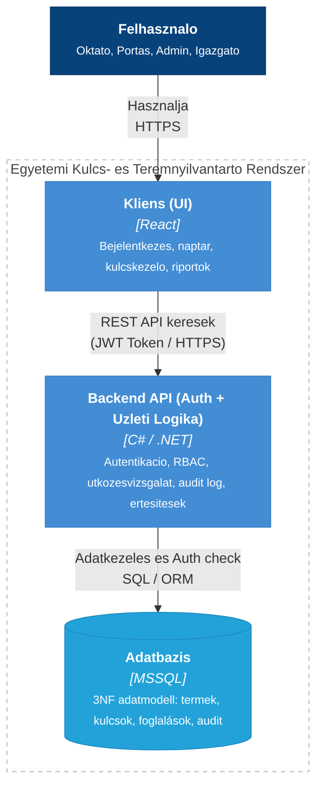
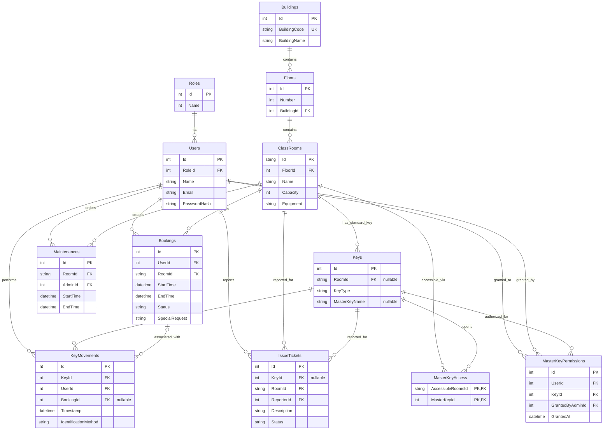

# egyetemi-kulcskezelo

Egyetemi Kulcs- és Teremnyilvántartó Rendszer PROJEKT LABOR - 2026/27/1 Csoport munka

---

## 1. A projekt celja es attekintese

Az egyetemi oktatasi termek, laborok, valamint a hozzajuk tartozo fizikai kulcsok nyilvantartasa gyakran manualisan, papiralapon tortenik, ami adminisztracios terhet, kulcselvesztest es foglalasi utkozeseket eredmenyez.

A rendszer celja egy kozpontositott, digitalis felulet biztositasa, amely:

- Valos idoben koveti a fizikai kulcsok kiadasat es visszavetelet.
- Kezeli az oktatok idopontalapu teremfoglalasait es a termek kapacitasat.
- Digitalis hibajegykezelo modult nyujt a serult kulcsok, zarak vagy teremi eszkozok bejelentesere.
- Adminisztratori engedelyhez koti a mesterkulcsok felvetelet es audit naplot vezet a folyamatokrol.

---

## 2. Szerepkorok es jogosultsagok

| Szerepkor    | Jogosultsagok es feladatok                                                                                                                                      |
| :----------- | :-------------------------------------------------------------------------------------------------------------------------------------------------------------- |
| **Oktato**   | Szabad termek keresese kapacitas alapjan, teremfoglalas inditasa, sajat foglalasok megtekintese, hibajegyek bejelentese.                                        |
| **Portas**   | Kulcsok fizikai kiadasanak es visszavetelenek gyors rogzitese, kulcsstatuszok lekerdezese (benn/kint), serulesek es vesztesegek azonnali jelzese.               |
| **Admin**    | Felhasznaloi fiokok es szerepkorok kezelese, uj termek es kulcsok felvitele, karbantartasok elrendelese, mesterkulcs-jogok kiosztasa, teljes audit log elerese. |
| **Igazgato** | Statisztikai kimutatasok, kihasznaltsagi riportok es hibanaplok megtekintese (olvasasi jog).                                                                    |

---

## 3. Rendszerinditas es fejlesztoi kornyezet

A projekt egy tobbkonteneres kornyezetben fut, amely magaban foglalja a **React** frontendet, a **.NET Core** backend REST API-t, valamint az **MSSQL** adatbazis-kiszolgalot. A teljes infrastruktura a legegyszerubben Docker segitsegevel indithato el.

### Elokovetelmenyek

- [Docker Desktop](https://www.docker.com/) telepitve es futtatva
- [Git](https://git-scm.com/)

### Gyors inditas

A projekt gyokerkonyvtaraban masold le a fejlesztoi kornyezet valtozoit tartalmazo mintafajlt, majd inditsd el a teljes stacket:

```bash
cp .env.sample .env
docker compose up --build
```

Az `.env.sample`-ben levo jelszavak kizarolag helyi fejlesztesi es tesztelesi celra valok. Eles kornyezetben allits be egyedi, biztonsagos ertekeket; a `.env` fajlt ne commitold.

**Fontos:** a `docker-compose.yml` `SEEDADMINEMAIL` es `SEEDADMINPASSWORD` valtozoneveket var, az `.env.sample` viszont `SEEDDATA_ADMINEMAIL` es `SEEDDATA_ADMINPASSWORD` neveket tartalmaz. Az inditas elott nevezd at ezt a ket sort a `.env` fajlban a Compose altal vart nevekre; kulonben az Admin fiok seedelese nem a mintabeli adatokkal tortenik.

A kontener-infrastruktura leallitasa:

```bash
docker compose down
```

### A futo szolgaltatasok portjai:

- Backend: 5000:8080
- Frontend: 3000:80
- Database: 1433:1433

### Fejlesztoi tesztfiok

Az elso inditaskor az adatbazis-seed letrehozza mind a negy szerepkort, es egy Admin felhasznalot. Az alabbi bejelentkezesi adatok az `.env.sample` fejlesztoi alapertelmezesei; a fent jelzett valtozonev-javitas utan hasznalhatok:

| Szerepkor | Nev           | E-mail / felhasznalonev | Jelszo                  |
| :-------- | :------------ | :---------------------- | :---------------------- |
| Admin     | Rendszergazda | `admin@example.com`     | `StrongDevPassword123!` |

Ez a fiok es jelszo csak fejlesztoi tesztadathoz valo, eles rendszerben ne hasznald. A seed nem hoz letre Oktato, Portas vagy Igazgato tesztfelhasznalot. Regisztracio utan az uj felhasznalonak nincs szerepkore; Admin fiokkal a felhasznalo kezelo feluleten rendelheto hozza. A szerepkorok ID-it a `GET /api/User/roles` vegponttal lehet lekerdezni.

---

## 4. Rendszerarchitektura (C4 Container szint)



---

## 5. Adatbazis sema (ER Diagram)



## 6. API dokumentáció

Az API alap URL-je fejleszteskor altalaban `http://localhost:5000`. Az alabbi utvonalak erre az alapra ertendok. A kapcsos zarojelben szereplo ertekeket valos azonositokra kell cserelni.

### Health es gyoker vegpont

| Method | Utvonal       | Leiras                                                            | Jogosultsag |
| ------ | ------------- | ----------------------------------------------------------------- | ----------- |
| GET    | `/`           | Egyszeru uzenettel jelzi, hogy az alkalmazas elindult.            | Nyilvanos   |
| GET    | `/api/health` | Az alkalmazas es az adatbazis health check allapotat adja vissza. | Nyilvanos   |

**Kodbazis-megjegyzes:** a `Program.cs` a `/api/health` utvonalra health check middleware-t is regisztral, mikozben a `HealthController` `[Route("api/[controller]")]` es `[HttpGet]` attributumai ugyanoda, `/api/Health` utvonalra oldodnak fel. Az utvonalak kis- es nagybetu-fuggetlenek, igy jelenleg ket GET endpoint van ugyanarra az utvonalra regisztralva; ezt erdemes a backendben egyetlen megoldasra egyszerusiteni.

### User

| Method | Utvonal                      | Leiras                                                                                                                           | Jogosultsag    |
| ------ | ---------------------------- | -------------------------------------------------------------------------------------------------------------------------------- | -------------- |
| GET    | `/api/User/{id}`             | A token alapjan bejelentkezett felhasznalo adatait adja vissza. Az `{id}` route-parametert a jelenlegi controller nem hasznalja. | Bejelentkezett |
| GET    | `/api/User`                  | Az osszes felhasznalot listazza.                                                                                                 | Admin          |
| GET    | `/api/User/info/{id}`        | Egy felhasznalo reszletes adatait adja vissza.                                                                                   | Admin          |
| GET    | `/api/User/roles`            | A szerepkorok listaja.                                                                                                           | Admin          |
| POST   | `/api/User/create`           | Felhasznalo regisztralasa. JSON: `Name`, `Email`, `Password`; JWT tokent ad vissza.                                              | Nyilvanos      |
| POST   | `/api/User/login`            | Bejelentkezes. JSON: `Email`, `Password`; JWT tokent ad vissza.                                                                  | Nyilvanos      |
| PUT    | `/api/User/update`           | A bejelentkezett felhasznalo adatainak modositasa. JSON: `Name`, `Email`, `Password`.                                            | Bejelentkezett |
| POST   | `/api/User/change-password`  | Jelszocsere. JSON: `OldPassword`, `NewPassword`, `ConfirmPassword`.                                                              | Bejelentkezett |
| DELETE | `/api/User/{id}`             | Felhasznalo torlese.                                                                                                             | Admin          |
| POST   | `/api/User/role/{userId}`    | A body-ban kapott egesz role ID-t hozzarendeli a felhasznalohoz.                                                                 | Admin          |
| POST   | `/api/User/role`             | Uj szerepkor letrehozasa. JSON: `Name`.                                                                                          | Admin          |
| DELETE | `/api/User/role/{id}`        | Szerepkor torlese azonosito alapjan.                                                                                             | Admin          |
| DELETE | `/api/User/role/remove/{id}` | Az `{id}` felhasznalorol eltavolitja a szerepkort.                                                                               | Admin          |

### Building

| Method | Utvonal                     | Leiras                                                    | Jogosultsag    |
| ------ | --------------------------- | --------------------------------------------------------- | -------------- |
| GET    | `/api/Building/getall`      | Az osszes epulettel kapcsolatos adatot visszaadja.        | Bejelentkezett |
| GET    | `/api/Building/get/{id}`    | Egy epulet alapadatai.                                    | Bejelentkezett |
| GET    | `/api/Building/info/{id}`   | Egy epulet reszletes adatai.                              | Bejelentkezett |
| POST   | `/api/Building/create`      | Epulet letrehozasa. JSON: `BuildingCode`, `BuildingName`. | Admin          |
| PUT    | `/api/Building/update/{id}` | Epulet modositasa. JSON: `BuildingCode`, `BuildingName`.  | Admin          |
| DELETE | `/api/Building/delete/{id}` | Epulet torlese.                                           | Admin          |

### Floor

| Method | Utvonal                      | Leiras                                            | Jogosultsag    |
| ------ | ---------------------------- | ------------------------------------------------- | -------------- |
| GET    | `/api/Floor/getall`          | Az osszes emeletet listazza.                      | Bejelentkezett |
| GET    | `/api/Floor/get/{id}`        | Egy emelet alapadatai.                            | Bejelentkezett |
| GET    | `/api/Floor/info/{id}`       | Egy emelet reszletes adatai.                      | Bejelentkezett |
| GET    | `/api/Floor/{floorId}/rooms` | Az adott emelet termeit listazza.                 | Bejelentkezett |
| POST   | `/api/Floor/create`          | Emelet letrehozasa. JSON: `Number`, `BuildingId`. | Admin          |
| PUT    | `/api/Floor/update/{id}`     | Emelet modositasa. JSON: `Number`, `BuildingId`.  | Admin          |
| DELETE | `/api/Floor/delete/{id}`     | Emelet torlese.                                   | Admin          |

### Room

| Method | Utvonal                 | Leiras                                                                     | Jogosultsag    |
| ------ | ----------------------- | -------------------------------------------------------------------------- | -------------- |
| GET    | `/api/Room/getall`      | Az osszes terem listaja.                                                   | Bejelentkezett |
| GET    | `/api/Room/get/{id}`    | Egy terem adatai.                                                          | Bejelentkezett |
| GET    | `/api/Room/info/{id}`   | Egy terem reszletes adatai.                                                | Bejelentkezett |
| POST   | `/api/Room/create`      | Terem letrehozasa. JSON: `Id`, `FloorId`, `Name`, `Capacity`, `Equipment`. | Admin          |
| PUT    | `/api/Room/update/{id}` | Terem modositasa. JSON: `FloorId`, `Name`, `Capacity`, `Equipment`.        | Admin          |
| DELETE | `/api/Room/delete/{id}` | Terem torlese.                                                             | Admin          |

### Booking

| Method | Utvonal                               | Leiras                                                                                    | Jogosultsag                                                                           |
| ------ | ------------------------------------- | ----------------------------------------------------------------------------------------- | ------------------------------------------------------------------------------------- |
| GET    | `/api/bookings/getall`                | Az osszes foglalast listazza.                                                             | Admin                                                                                 |
| GET    | `/api/bookings/user/{userId}`         | Egy felhasznalo foglalasait listazza.                                                     | Bejelentkezett felhasznalo csak sajat ID-val; Admin barmelyik felhasznaloet lekerheti |
| POST   | `/api/bookings`                       | Foglalas letrehozasa. JSON: `UserId`, `RoomId`, `StartTime`, `EndTime`, `SpecialRequest`. | Oktato vagy szerepkor nelkuli felhasznalo, csak sajat `UserId` ertekkel               |
| DELETE | `/api/bookings?bookingId={bookingId}` | Foglalas torlese azonosito alapjan.                                                       | A tulajdonos vagy Admin                                                               |

**Hitelesites es jogosultsagok**

- A `POST /api/User/create` es `POST /api/User/login` vegpontok nyilvanosak; mindketto JWT tokent ad vissza.
- A tobbi User vegpont hitelesitest igenyel. A token fejlece: `Authorization: Bearer <JWT_TOKEN>`.
- A `GET /api/User` es `GET /api/User/roles`, valamint az adminisztracios felhasznalo- es role-muveletek Admin szerepkort igenyelnek.
- A Building, Floor es Room lekerdezo vegpontjai bejelentkezest igenyelnek; letrehozasuk, modositasuk es torlesuk Admin szerepkorhoz kotott.
- Foglalast Oktato vagy szerepkor nelkuli, bejelentkezett felhasznalo hozhat letre, es csak sajat felhasznaloi azonositojaval. Mas kiosztott szerepkor nem hozhat letre foglalast.
- A sajat felhasznaloi adatok lekerdezese es modositasa, valamint a jelszocsere minden bejelentkezett felhasznalo szamara elerheto, szerepkortol fuggetlenul.
- A `GET /api/bookings/getall` Admin jogosultsagot igenyel. A felhasznalo a sajat foglalasait kerheti le es torolheti; Admin barmelyik felhasznalo foglalasait listazhatja es torolheti. Foglalas letrehozasanal az Admin sem lepheti at a POST vegpont Oktato/szerepkor nelkuli jogosultsagi es sajat-felhasznaloi-ID ellenorzeset.
- A hitelesitett keresek fejlece: `Authorization: Bearer <JWT-token>`.

**Jelenleg nem dokumentalhato, mert nincs hozza API controller:** a kulcsmozgatasok, hibajegyek, karbantartasok es mesterkulcs-jogosultsagok entitasaihoz nincs kulon HTTP vegpont a jelenlegi kodbazisban.
