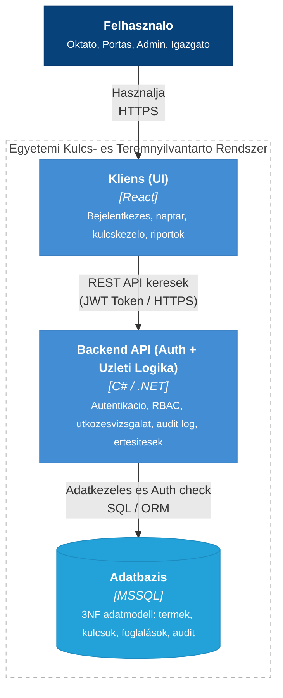
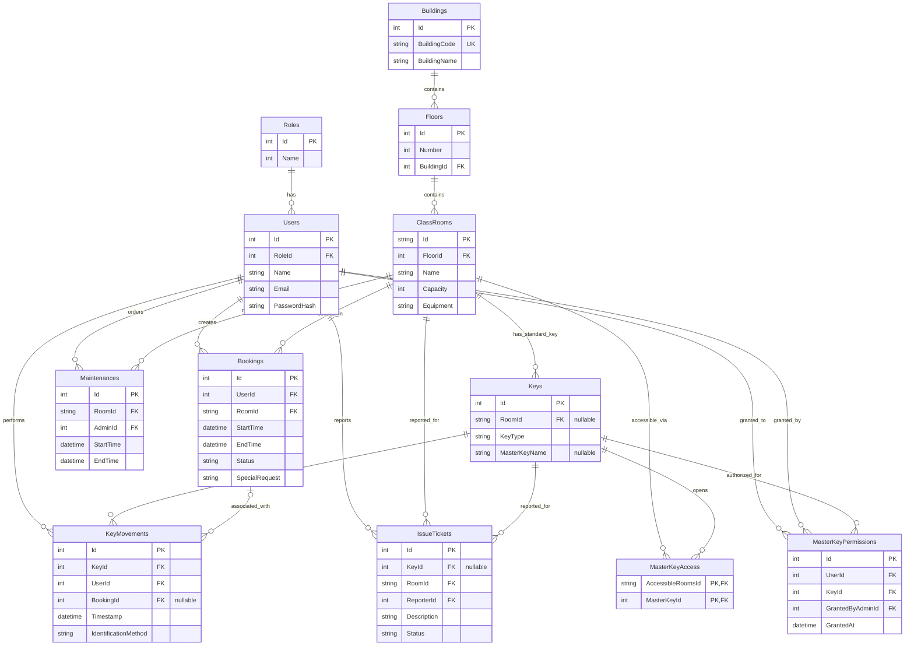

# egyetemi-kulcskezelo

Egyetemi Kulcs- és Teremnyilvántartó Rendszer PROJEKT LABOR - 2026/27/1 Csoport munka

---

## 1. A projekt celja es attekintese

Az egyetemi oktatasi termek, laborok, valamint a hozzajuk tartozo fizikai kulcsok nyilvantartasa gyakran manualisan, papiralapon tortenik, ami adminisztracios terhet, kulcselvesztest es foglalasi utkozeseket eredmenyez.

A rendszer celja egy kozpontositott, digitalis felulet biztositasa, amely:

- Valos idoben koveti a fizikai kulcsok kiadasat es visszavetelet.
- Kezeli az oktatok idopontalapu teremfoglalasait es a termek kapacitasat.
- Digitalis hibajegykezelo modult nyujt a serult kulcsok, zarak vagy teremi eszkozok bejelentesere.
- Adminisztratori engedelyhez koti a mesterkulcsok felvetelet es audit naplot vezet a folyamatokrol.

---

## 2. Szerepkorok es jogosultsagok

| Szerepkor    | Jogosultsagok es feladatok                                                                                                                                      |
| :----------- | :-------------------------------------------------------------------------------------------------------------------------------------------------------------- |
| **Oktato**   | Szabad termek keresese kapacitas alapjan, teremfoglalas inditasa, sajat foglalasok megtekintese, hibajegyek bejelentese.                                        |
| **Portas**   | Kulcsok fizikai kiadasanak es visszavetelenek gyors rogzitese, kulcsstatuszok lekerdezese (benn/kint), serulesek es vesztesegek azonnali jelzese.               |
| **Admin**    | Felhasznaloi fiokok es szerepkorok kezelese, uj termek es kulcsok felvitele, karbantartasok elrendelese, mesterkulcs-jogok kiosztasa, teljes audit log elerese. |
| **Igazgato** | Statisztikai kimutatasok, kihasznaltsagi riportok es hibanaplok megtekintese (olvasasi jog).                                                                    |

---

## 3. Rendszerinditas es fejlesztoi kornyezet

A projekt egy tobbkonteneres kornyezetben fut, amely magaban foglalja a **React** frontendet, a **.NET Core** backend REST API-t, valamint az **MSSQL** adatbazis-kiszolgalot. A teljes infrastruktura a legegyszerubben Docker segitsegevel indithato el.

### Elokovetelmenyek

- [Docker Desktop](https://www.docker.com/) telepitve es futtatva
- [Git](https://git-scm.com/)

### Gyors inditas

A projekt gyokerkonyvtaraban futtasd a kovetkezo parancsot:

```bash
docker compose up --build
```

A kontener-infrastruktura leallitasa:

```bash
docker compose down
```

### A futo szolgaltatasok portjai:

- Backend: 5000:8080
- Frontend: 3000:80
- Database: 1433:1433

---

## 4. Rendszerarchitektura (C4 Container szint)



---

## 5. Adatbazis sema (ER Diagram)



## 6. API dokumentáció

**Health**

- GET /api/Health: A rendszer es az adatbazis-kapcsolat valos ideju allapotanak lekerdezese.

**KulcsRendszer.API**

- GET / : Alapertelmezett gyoker vegpont az API futasanak es elerhetosegenek ellenorzesere.

**User**

- GET /api/User/{id} : Egy adott azonositoju felhasznalo alapveto adatainak lekerdezese.
- DELETE /api/User/{id} : Felhasznalo torlese a rendszerbol id alapjan.
- POST /api/User/create : Uj felhasznalo regisztracioja / letrehozasa a rendszerben.
- PUT /api/User/update/{id} : Meglevo felhasznalo adatainak modositasa.
- POST /api/User/change-password/{id} : Felhasznalo jelszavanak biztonsagos megvaltoztatasa.
- POST /api/User/role/{userId} : Szerepkor hozzarendelese egy adott azonositoju felhasznalohoz.
- POST /api/User/role : Uj szerepkor hozzaadasa / letrehozasa a rendszerben.
- DELETE /api/User/role/{Id} : Szerepkor torlese a rendszerbol id alapjan.
- DELETE /api/User/role/remove/{Id} : Szerepkor eltavolita egy felhasznalotol vagy a rendszerbol id alapjan.

**Floor**

- GET /api/Floor/getall : Az osszes emelet listajanak lekerdezese a rendszerbol.
- GET /api/Floor/get/{id} : Egy adott azonositoju emelet alapadatainak lekerdezese.
- GET /api/Floor/info/{id} : Egy adott azonositoju emelet reszletes informacioinak lekerdezese.
- GET /api/Floor/{floorId}/rooms : Egy adott emelethez tartozo termek listajanak es azok tulajdonsagainak lekerdezese.
- POST /api/Floor/create : Uj emelet letrehozasa a rendszerben.
- PUT /api/Floor/update/{id} : Meglevo emelet adatainak modositasa id alapjan.
- DELETE /api/Floor/delete/{id} : Emelet torlese a rendszerbol id alapjan.

**Building**

- GET /api/Building/getall : Az epuletek teljes listajanak lekerdezese a rendszerbol.
- GET /api/Building/get/{id} : Egy adott azonositoju epulet alapadatainak lekerdezese.
- GET /api/Building/info/{id} : Egy adott azonositoju epulet reszletes informacioinak lekerdezese.
- POST /api/Building/create : Uj epulet letrehozasa a rendszerben.
- PUT /api/Building/update/{id} : Meglevo epulet adatainak modositasa id alapjan.
- DELETE /api/Building/delete/{id} : Epulet torlese a rendszerbol id alapjan.
